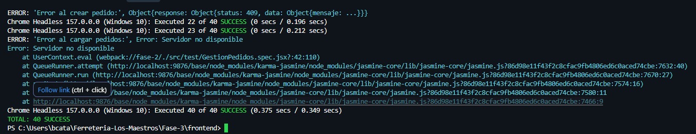
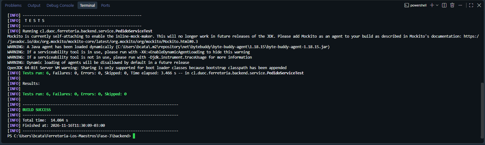

# DOCUMENTACIÓN DE INTEGRACIÓN DEL SISTEMA
## Ferretería Los Maestros — Fase 3

**Módulo:** Compras y Pedidos  
**Frontend:** React (Vite)  
**Backend:** Java 21, Spring Boot  
**Persistencia prevista:** Oracle Database, Spring Data JPA y Flyway  
**Estado:** implementación desarrollada y pruebas aisladas aprobadas; integración con Oracle pendiente de comprobar.

---

## 1. Objetivo y alcance

Explicar cómo interactúan los componentes de Compras y Pedidos, desde la selección de un producto hasta el registro y la administración de un pedido. Esta documentación corresponde al código de la Fase 3. **No documenta una pasarela de pago real:** la selección de medio de pago de la interfaz es referencial.

## 2. Arquitectura

```text
Cliente / Administrador
          |
          v
  React (interfaz web)
          |
          | HTTP + JSON + JWT
          v
 Spring Boot (API REST)
          |
          | Controlador -> Servicio -> Repositorios JPA
          v
 Oracle Database (persistencia prevista)
```

- **React:** muestra productos, administra temporalmente el carrito, envía pedidos y presenta la gestión administrativa.
- **Spring Boot:** autentica y autoriza, valida cantidades y stock, calcula montos, procesa cambios de estado y coordina operaciones transaccionales.
- **Oracle:** fuente de persistencia prevista para usuarios, productos, pedidos y sus detalles. Su conexión real aún no ha sido verificada durante esta entrega.

## 3. Archivos principales

| Capa | Archivo | Responsabilidad |
|---|---|---|
| Frontend | `src/components/ProductoCard.jsx` | Agregar productos disponibles al carrito. |
| Frontend | `src/pages/Carrito.jsx` | Mostrar carrito, modificar cantidades y solicitar registro de pedidos. |
| Frontend | `src/pages/admin/GestionPedidos.jsx` | Consultar pedidos y actualizar estados. |
| Frontend | `src/api/axiosConfig.js` | Configuración de Axios, dirección de API e inclusión del token. |
| Frontend | `src/api/pedidoService.js` | Funciones para los cuatro endpoints de pedidos. |
| Backend | `controller/PedidoController.java` | Exponer los endpoints REST y sus códigos HTTP. |
| Backend | `service/PedidoService.java` | Reglas de negocio del pedido y del inventario. |
| Backend | `model/Pedido.java`, `model/DetallePedido.java` | Modelo de datos del pedido y sus líneas. |
| Backend | `repository/PedidoRepository.java` | Acceso a pedidos, incluido bloqueo al actualizar. |
| Backend | `repository/ProductoRepository.java` | Acceso a productos, incluido bloqueo para compras. |
| Base de datos | `db/migration/V3__Pedidos.sql` | Definición de tablas para pedidos y sus detalles. |

Las rutas relativas de frontend comienzan en `Fase-3/frontend/src/`; las de Java en `Fase-3/backend/src/main/java/cl/duoc/ferreteria/backend/`.

## 4. Comunicación HTTP

El frontend configura Axios con la dirección base de desarrollo `http://localhost:8080/api`. Los métodos de `pedidoService.js` llaman a las rutas `/v1/pedidos` y sus variantes, por lo que la URL completa de pedidos es:

`http://localhost:8080/api/v1/pedidos`

Las solicitudes protegidas llevan el encabezado `Authorization: Bearer <TOKEN_JWT>` si hay un token almacenado por el mecanismo de inicio de sesión. Las solicitudes con cuerpo usan JSON.

| Método | Ruta | Propósito |
|---|---|---|
| `POST` | `/api/v1/pedidos` | Registrar compra y descontar stock. |
| `GET` | `/api/v1/pedidos` | Consultar listado de pedidos. |
| `GET` | `/api/v1/pedidos/{id}` | Consultar un pedido y sus detalles. |
| `PATCH` | `/api/v1/pedidos/{id}/estado` | Cambiar estado; al cancelar, restituir stock. |

La autorización se configura en `SecurityConfig.java`; en la implementación revisada, crear pedidos corresponde a usuarios autorizados como cliente o administrador, consultar pedidos a perfiles administrativos/de venta y cambiar estados a administrador.

## 5. Flujo de compra

1. El cliente consulta el catálogo y agrega productos a `ProductoCard.jsx`.
2. El carrito conserva temporalmente identificadores de productos y cantidades mediante las funciones de almacenamiento local de `MockDB`. **No es la base de datos definitiva de pedidos.**
3. `Carrito.jsx` consulta datos actualizados de productos y verifica requisitos básicos, como sesión, carrito y cantidades.
4. El frontend envía `POST /api/v1/pedidos` con `{ "productos": [{ "productoId": 1, "cantidad": 2 }] }`.
5. El controlador obtiene al usuario autenticado y delega en `PedidoService`.
6. El servicio valida usuario, productos y cantidades; accede a productos con bloqueo pesimista y verifica el stock disponible.
7. Calcula el subtotal de cada línea y el total; disminuye el stock y actualiza la disponibilidad (`Disponible`, `Stock bajo` o `Sin stock`).
8. Crea `Pedido` con estado inicial `PENDIENTE` y sus `DetallePedido`, y lo guarda mediante el repositorio.
9. El controlador responde con HTTP `201` e información del pedido: `id`, `estado`, `total` y `fechaPedido`.
10. **Solo tras una respuesta exitosa** React muestra confirmación y vacía el carrito. Si falla la solicitud, conserva los productos para corrección/reintento.

La operación de servicio está anotada con `@Transactional`. Se requiere una prueba sobre Oracle real para comprobar el comportamiento efectivo de persistencia y reversión de transacciones.

## 6. Flujo administrativo

1. El administrador abre `GestionPedidos.jsx`.
2. La interfaz obtiene los pedidos mediante `GET /api/v1/pedidos`; presenta lista, búsqueda y detalles.
3. Para actualizar un pedido envía `PATCH /api/v1/pedidos/{id}/estado` con un JSON como `{ "estado": "EN_PREPARACION" }`.
4. El servicio valida y normaliza el nuevo estado, consulta el pedido con bloqueo pesimista y comprueba la transición:

| Estado actual | Cambios permitidos |
|---|---|
| `PENDIENTE` | `EN_PREPARACION`, `CANCELADO` |
| `EN_PREPARACION` | `ENTREGADO`, `CANCELADO` |
| `ENTREGADO` | Ninguno |
| `CANCELADO` | Ninguno |

5. Si el cambio permitido es a `CANCELADO`, devuelve al stock la cantidad de cada detalle y recalcula la disponibilidad del producto. Luego guarda el nuevo estado.
6. Devuelve un `PedidoResponse` con identificador, cliente, fecha, estado, total y detalles.

El servicio trata el cambio al mismo estado como una operación sin modificación. Las transiciones inválidas se rechazan con HTTP `409`.

## 7. Modelo de datos y migración

- **PEDIDOS:** identifica la compra, usuario asociado, fecha, estado y total.
- **DETALLE_PEDIDO:** vincula cada pedido con sus productos, cantidades, precios unitarios y subtotales.
- **PRODUCTOS:** suministra precios y stock; se actualiza en compras y cancelaciones.

La migración `V3__Pedidos.sql` crea las tablas correspondientes. Su ejecución efectiva en Oracle sigue pendiente de comprobación porque no se ha probado el arranque con Wallet/configuración de conexión.

## 8. Errores contemplados

| Situación | Respuesta habitual del servicio |
|---|---|
| Pedido vacío o cantidades inválidas | HTTP `400` |
| Usuario no autenticado/no encontrado | HTTP `401` (según capa de autenticación) |
| Rol sin permisos | HTTP `403` |
| Producto o pedido inexistente | HTTP `404` |
| Stock insuficiente o transición no permitida | HTTP `409` |
| Error de conexión/servidor | Se informa al usuario; el carrito no debe vaciarse. |

Las respuestas específicas dependen también del manejo global de errores y de Spring Security.

## 9. Pruebas disponibles

- **React:** 40 pruebas exitosas con componentes y llamadas API simuladas.
- **Spring Boot:** 6 pruebas unitarias exitosas de `PedidoServiceTest`, con JUnit y Mockito.
- **Compilación:** frontend y backend compilados satisfactoriamente.

Evidencias locales:





**Límite de estas evidencias:** no acreditan por sí solas que los endpoints se hayan ejecutado contra Oracle.

## 10. Verificaciones pendientes

- Obtener y configurar de forma segura el Wallet de Oracle, sin agregarlo a Git.
- Iniciar Spring Boot y comprobar conectividad.
- Verificar que Flyway aplica la migración en la base real.
- Probar registro, consulta, cambios de estado y cancelación persistentes.
- Probar el circuito completo React → API → Oracle con JWT real.
- Verificar Swagger/OpenAPI con el servidor ejecutándose.

## 11. Conclusión

Se ha implementado el flujo de Compras y Pedidos en React y Spring Boot, con control de stock, gestión de estados y pruebas automatizadas aisladas. La validación de integración completa con Oracle está expresamente pendiente.
