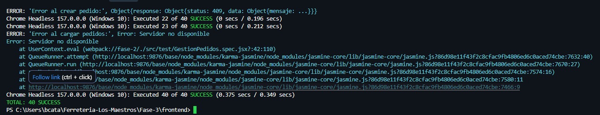
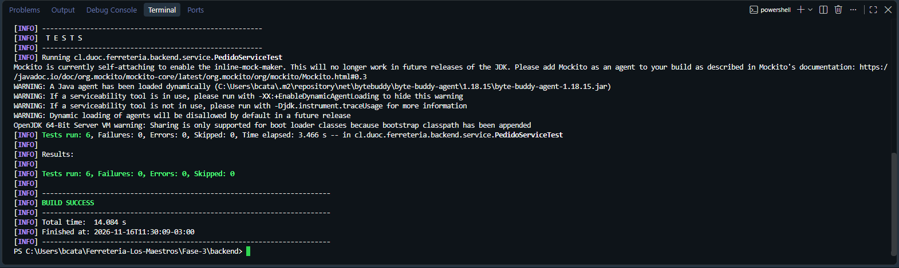

MANUAL DE USUARIO
Ferretería Los Maestros

Módulo: Compras y Pedidos  
Evaluación: Fase 3  
Tecnologías: React y Spring Boot

1. Introducción

El presente manual tiene como objetivo explicar el funcionamiento del módulo de Compras y Pedidos del sistema web Ferretería Los Maestros.

Este módulo permite a los clientes seleccionar productos, agregarlos a un carrito de compras y registrar pedidos.

También permite a los administradores consultar los pedidos realizados y gestionar sus estados.

2. Objetivo del módulo

Facilitar el proceso de compra de productos de ferretería mediante una aplicación web conectada a un sistema de gestión de pedidos e inventario.

Entre sus principales funcionalidades se encuentran:

- Visualización de productos disponibles.
- Incorporación de productos al carrito.
- Modificación de cantidades.
- Validación de stock disponible.
- Registro de pedidos.
- Consulta de pedidos por administradores.
- Actualización del estado de los pedidos.
- Recuperación del stock cuando un pedido es cancelado.

3. Tipos de usuarios

Cliente: puede agregar productos al carrito y registrar pedidos mediante su cuenta.

Administrador: puede consultar pedidos registrados, revisar sus detalles y actualizar sus estados.

4. Consideraciones importantes

El carrito almacena temporalmente los productos seleccionados.

Cuando el cliente confirma la operación, la aplicación envía la solicitud al backend para registrar el pedido y actualizar el inventario.

La selección de un medio de pago en la interfaz es referencial. El módulo implementado no realiza cobros reales ni procesa transacciones bancarias.

Estado de validación: las funcionalidades cuentan con pruebas automatizadas, pero la integración completa con la base de datos Oracle todavía está pendiente de verificación.

5. Uso del carrito de compras

El carrito de compras permite a los clientes seleccionar productos de la ferretería, modificar sus cantidades y registrar pedidos.

5.1. Agregar productos al carrito

Para agregar un producto, el cliente debe:

1. Ingresar al catálogo de productos.
2. Buscar el producto que desea comprar.
3. Revisar su precio y stock disponible.
4. Presionar el botón Agregar.
5. Verificar el mensaje de confirmación.

El sistema almacena temporalmente el producto seleccionado en el carrito de compras.

Si el producto no tiene stock, el botón para agregarlo permanece deshabilitado.

5.2. Consultar el carrito

Para revisar los productos seleccionados, el cliente debe ingresar a la sección Carrito de compras.

En esta sección podrá visualizar:

- Productos agregados.
- Precio unitario de cada producto.
- Cantidad seleccionada.
- Subtotal por producto.
- Total general del pedido.

5.3. Modificar cantidades

El cliente puede aumentar o disminuir la cantidad de productos seleccionados.

El sistema comprueba que la cantidad solicitada no supere el stock disponible.

Los valores del pedido se actualizan según las cantidades seleccionadas.

5.4. Eliminar productos

Si el cliente ya no desea comprar un producto, puede eliminarlo del carrito.

Al realizar esta acción, el producto deja de formar parte del pedido y el total se actualiza.

5.5. Registrar un pedido

Para registrar un pedido, el cliente debe:

1. Revisar los productos agregados al carrito.
2. Confirmar las cantidades solicitadas.
3. Iniciar sesión con su cuenta, si todavía no lo ha hecho.
4. Seleccionar una opción de pago referencial.
5. Presionar el botón Registrar pedido.

El sistema envía la información al backend mediante una solicitud HTTP.

Si el pedido se registra correctamente:

- Se genera un identificador del pedido.
- El pedido queda inicialmente en estado 'pendiente'.
- Se descuenta el stock correspondiente.
- Se muestra un mensaje de confirmación.
- Se vacía el carrito de compras.

Importante: El registro del pedido no significa que se haya realizado un cobro bancario.

5.6. Posibles errores

El sistema puede impedir el registro del pedido cuando:

- El carrito está vacío.
- El cliente no ha iniciado sesión.
- Un producto no tiene stock suficiente.
- Existe un error de comunicación con el servidor.

En estos casos, se muestra un mensaje informativo para que el cliente pueda corregir el problema.

El carrito no se vacía cuando falla el registro del pedido.

6. Gestión administrativa de pedidos

El módulo de Gestión de Pedidos permite a los administradores consultar las compras registradas por los clientes, revisar sus detalles y actualizar el estado de cada pedido.

6.1. Acceder a la gestión de pedidos

Para acceder al módulo, el administrador debe:

1. Iniciar sesión con una cuenta que tenga permisos de administrador.
2. Ingresar al panel de administración.
3. Seleccionar la opción **Gestión de Pedidos**.
4. Esperar a que el sistema cargue los pedidos registrados.

El sistema consulta los pedidos mediante la API REST del backend.

6.2. Consultar los pedidos

En esta sección, el administrador puede visualizar información como:

- Identificador del pedido.
- Nombre del cliente.
- Fecha de registro.
- Monto total.
- Estado actual.

También puede utilizar el buscador para localizar pedidos por identificador o nombre del cliente.

6.3. Revisar el detalle de un pedido

Para consultar la información de una compra, el administrador debe:

1. Localizar el pedido correspondiente.
2. Abrir su detalle.
3. Revisar los productos incluidos.

El sistema muestra información de cada producto, como su nombre, cantidad, precio unitario y subtotal.

6.4. Actualizar el estado de un pedido

Los pedidos pueden presentar los siguientes estados:

PENDIENTE: el pedido fue registrado y espera ser procesado.

EN_PREPARACION: el pedido se encuentra en proceso de preparación.

ENTREGADO: el pedido fue entregado al cliente.

CANCELADO: el pedido fue cancelado y sus productos deben regresar al inventario.

Para cambiar el estado, el administrador debe:

1. Seleccionar el pedido correspondiente.
2. Revisar su estado actual.
3. Elegir un nuevo estado permitido.
4. Confirmar la actualización.
5. Verificar que el sistema muestre el estado actualizado.

6.5. Reglas de cambio de estado

El sistema permite únicamente las siguientes transiciones:

| Estado actual | Estados permitidos    |
| PENDIENTE | EN_PREPARACION, CANCELADO |
| EN_PREPARACION | ENTREGADO, CANCELADO |
| ENTREGADO | No permite nuevos cambios |
| CANCELADO | No permite nuevos cambios |

Estas restricciones evitan modificaciones incorrectas en el proceso de compra.

6.6. Cancelación de pedidos

Cuando un administrador cancela un pedido válido, el backend ejecuta las siguientes operaciones:

1. Identifica los productos incluidos en el pedido.
2. Consulta el stock actual de cada producto.
3. Devuelve al inventario las unidades correspondientes.
4. Actualiza la disponibilidad de los productos.
5. Cambia el estado del pedido a 'cancelado.
6. Guarda los cambios.

Por ejemplo, si un pedido contiene dos martillos y el inventario tiene tres unidades después de la compra, al cancelar el pedido el stock vuelve a cinco unidades.

Importante: Las reglas de cancelación fueron verificadas mediante pruebas unitarias. Su funcionamiento con Oracle todavía requiere pruebas de integración.

6.7. Posibles errores

Durante la gestión de pedidos pueden presentarse las siguientes situaciones:

- El pedido solicitado no existe.
- El usuario no tiene permisos suficientes.
- Se intenta realizar un cambio de estado no permitido.
- No se logra establecer comunicación con el servidor.

El sistema debe informar el problema y evitar modificaciones incorrectas.

7. Capturas de pantalla y evidencias

Esta sección reúne las evidencias visuales y técnicas del módulo de Compras y Pedidos de Ferretería Los Maestros.

Las capturas permitirán demostrar el funcionamiento de las principales características implementadas.

7.1. Catálogo de productos

Descripción: pantalla que permite visualizar los productos disponibles, sus precios y cantidades en inventario.

Evidencia pendiente: incorporar una captura del catálogo de productos.

7.2. Carrito de compras

Descripción: pantalla donde el cliente puede revisar los productos seleccionados, modificar cantidades y consultar el total del pedido.

Evidencia pendiente: incorporar una captura del carrito de compras.

7.3. Registro de pedidos

Descripción: proceso mediante el cual un cliente confirma los productos seleccionados y solicita el registro de un pedido.

Evidencia pendiente: incorporar una captura de la confirmación de un pedido registrado correctamente.

7.4. Gestión administrativa de pedidos

Descripción: interfaz administrativa que permite consultar pedidos, visualizar sus detalles y actualizar sus estados.

Evidencia pendiente: incorporar una captura de la pantalla de Gestión de Pedidos.

7.5. Pruebas automatizadas del frontend

Se ejecutaron 40 pruebas automatizadas para comprobar diferentes funcionalidades de la aplicación React.

Resultado obtenido:**

- Pruebas ejecutadas: 40.
- Pruebas exitosas: 40.
- Pruebas fallidas: 0.

7.6. Pruebas automatizadas del backend

Se ejecutaron 6 pruebas unitarias mediante JUnit y Mockito para validar las principales reglas de negocio de Compras y Pedidos.

Las pruebas verificaron la creación de pedidos, el cálculo de totales, la actualización del inventario, la validación de stock, los cambios de estado y la cancelación de pedidos.

Resultado obtenido:

- Pruebas ejecutadas: 6.
- Pruebas exitosas: 6.
- Pruebas fallidas: 0.

7.7. Estado de las pruebas de integración

Las pruebas automatizadas realizadas utilizan componentes y repositorios simulados.

La integración completa entre React, Spring Boot y Oracle todavía requiere una verificación con la base de datos real.

Por este motivo, las capturas de operaciones exitosas con Oracle se incorporarán únicamente cuando se haya comprobado su funcionamiento.