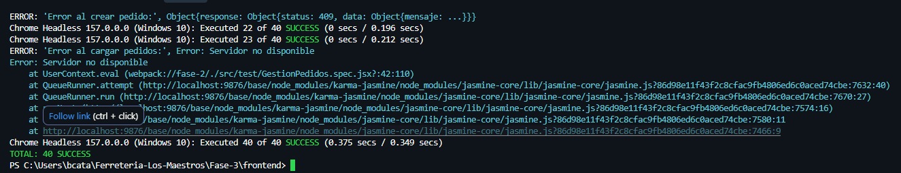
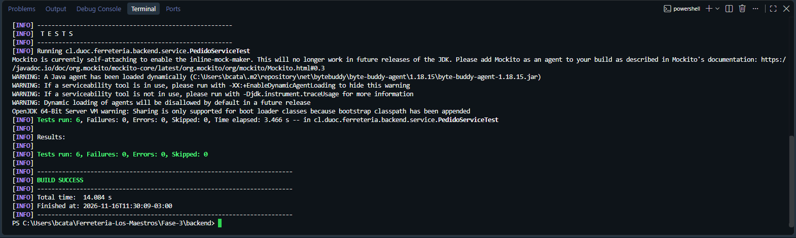

# ESPECIFICACIÓN DE REQUISITOS DEL SISTEMA (ERS)
## Ferretería Los Maestros — Módulo Compras y Pedidos

**Versión:** 1.0  
**Fase:** 3  
**Tecnologías:** React, Spring Boot, Oracle (persistencia prevista)  
**Alcance:** requisitos del módulo implementado; no describe otros módulos del proyecto grupal.

---

## 1. Propósito

Establecer los requisitos funcionales, reglas de negocio, criterios de aceptación y restricciones del módulo Compras y Pedidos. Se busca permitir que un cliente prepare y registre una compra y que los usuarios con permisos administrativos consulten y gestionen los pedidos.

## 2. Actores

| Actor | Participación |
|---|---|
| Cliente autenticado | Selecciona productos, modifica el carrito y registra un pedido. |
| Administrador | Consulta pedidos, inspecciona detalles y cambia estados válidos. |
| Personal de venta autorizado | Puede consultar pedidos según los permisos configurados. |
| Sistema | Valida datos, aplica reglas de stock y registra transacciones. |

## 3. Requisitos funcionales

| ID | Requisito | Prioridad | Criterio de aceptación |
|---|---|---|---|
| RF-01 | Visualizar productos con nombre, precio y disponibilidad. | Alta | El catálogo muestra información recibida del backend y distingue productos sin stock. |
| RF-02 | Agregar un producto al carrito. | Alta | El botón «Agregar» incorpora un producto válido y muestra confirmación. |
| RF-03 | Evitar agregar unidades por encima del stock conocido. | Alta | La interfaz bloquea la cantidad que supera el stock mostrado. |
| RF-04 | Consultar productos y totales del carrito. | Alta | Se muestran artículos, cantidades, subtotales y total. |
| RF-05 | Modificar cantidades y eliminar artículos. | Alta | La selección y los importes se actualizan; el carrito se almacena temporalmente. |
| RF-06 | Exigir autenticación para registrar un pedido. | Alta | Un intento sin sesión válida se bloquea. |
| RF-07 | Registrar pedidos mediante API REST. | Alta | `POST /api/v1/pedidos` recibe lista de `productoId` y `cantidad`, y responde `201` cuando se registra. |
| RF-08 | Validar el contenido de un pedido. | Alta | Se rechazan carrito vacío, ítems nulos, ID faltante o cantidad menor que uno. |
| RF-09 | Comprobar existencia y stock del producto en el servidor. | Alta | Producto inexistente produce `404`; stock insuficiente produce `409`. |
| RF-10 | Calcular total a partir de precios y cantidades. | Alta | Cada detalle almacena precio unitario y subtotal; el pedido guarda la suma total. |
| RF-11 | Descontar inventario al crear pedidos. | Alta | El stock se reduce por la cantidad solicitada y cambia su estado de disponibilidad. |
| RF-12 | Guardar pedido y detalles asociados. | Alta | Se crea un pedido `PENDIENTE` con sus líneas de detalle. |
| RF-13 | Vaciar el carrito solo tras registro exitoso. | Alta | Se conserva el carrito si la API rechaza la solicitud. |
| RF-14 | Listar pedidos a usuarios autorizados. | Alta | `GET /api/v1/pedidos` entrega la colección de pedidos y detalles. |
| RF-15 | Consultar un pedido por identificador. | Media | `GET /api/v1/pedidos/{id}` devuelve pedido o `404`. |
| RF-16 | Filtrar pedidos por identificador o cliente en la interfaz. | Media | El administrador localiza pedidos desde el buscador de la pantalla. |
| RF-17 | Cambiar el estado de un pedido. | Alta | `PATCH /api/v1/pedidos/{id}/estado` acepta transiciones autorizadas. |
| RF-18 | Rechazar transiciones de estado prohibidas. | Alta | Una transición inválida devuelve `409` sin guardar el nuevo estado. |
| RF-19 | Reponer stock al cancelar un pedido válido. | Alta | Se restituyen las cantidades de los detalles y se recalcula el estado de inventario. |
| RF-20 | Aplicar autorización por roles a los endpoints. | Alta | Clientes, administradores y vendedores acceden solo a operaciones permitidas. |
| RF-21 | Mostrar mensajes de éxito y error. | Media | La interfaz informa registro correcto, problemas de stock y errores de servicio. |

**Nota:** Estos criterios reflejan el comportamiento diseñado e implementado en código. Su aprobación en una base Oracle real requiere las pruebas pendientes de integración.

## 4. Reglas de negocio

| ID | Regla |
|---|---|
| RN-01 | Un pedido debe contener al menos un producto. |
| RN-02 | Cada detalle debe tener un identificador de producto y una cantidad entera positiva. |
| RN-03 | No se registra una compra si el stock del servidor es insuficiente. |
| RN-04 | Subtotal = precio unitario × cantidad; total = suma de subtotales. |
| RN-05 | El estado inicial de todo pedido registrado es `PENDIENTE`. |
| RN-06 | `PENDIENTE` solo puede pasar a `EN_PREPARACION` o `CANCELADO`. |
| RN-07 | `EN_PREPARACION` solo puede pasar a `ENTREGADO` o `CANCELADO`. |
| RN-08 | No se permiten cambios desde `ENTREGADO` ni desde `CANCELADO`. |
| RN-09 | La cancelación permitida devuelve al inventario las unidades del pedido. |
| RN-10 | Si stock = 0, disponibilidad `Sin stock`; si 0 < stock ≤ mínimo, `Stock bajo`; en otro caso, `Disponible`. |
| RN-11 | El cliente no efectúa un pago real desde este módulo: las opciones de pago mostradas son referenciales. |
| RN-12 | El carrito se vacía únicamente después de una respuesta exitosa de creación del pedido. |

## 5. Casos de uso principales

### CU-01. Registrar pedido

**Actor:** cliente autenticado.  
**Precondiciones:** catálogo disponible, carrito con al menos un artículo y credenciales válidas.  
**Flujo:** seleccionar productos → revisar cantidades → confirmar registro → enviar solicitud → validar inventario → crear pedido → mostrar identificador de confirmación.  
**Excepciones:** falta de sesión, producto inexistente, datos inválidos, stock insuficiente o error del servidor.  
**Poscondición de éxito:** pedido `PENDIENTE` guardado y stock descontado; interfaz vacía el carrito.

### CU-02. Consultar pedidos

**Actor:** administrador o personal autorizado.  
**Precondiciones:** sesión con permisos de consulta.  
**Flujo:** abrir gestión → solicitar listado → filtrar por cliente/ID → revisar detalles.  
**Excepciones:** falta de permisos o error de conexión.

### CU-03. Actualizar o cancelar pedido

**Actor:** administrador.  
**Precondiciones:** pedido existente, sesión autorizada y transición permitida.  
**Flujo:** seleccionar pedido → escoger estado válido → enviar solicitud PATCH → validar transición → actualizar y responder.  
**Poscondición específica de cancelación:** stock restituido al inventario.  
**Excepciones:** pedido inexistente, estado inválido, transición prohibida o fallo del servidor.

## 6. Requisitos no funcionales

| ID | Requisito | Observación de verificación |
|---|---|---|
| RNF-01 | Comunicación entre frontend y backend mediante HTTP y JSON. | Implementada mediante Axios y controladores REST. |
| RNF-02 | Autenticación JWT y autorización por roles. | Configurada; requiere prueba extremo a extremo. |
| RNF-03 | Operaciones de compra y cancelación transaccionales. | Métodos con `@Transactional`; falta validación con Oracle. |
| RNF-04 | Protección ante compras concurrentes. | Consultas con bloqueo pesimista; falta prueba concurrente real. |
| RNF-05 | Mensajes comprensibles ante errores. | Implementados en la interfaz; cubiertos parcialmente por pruebas simuladas. |
| RNF-06 | Código organizado por controlador, servicio, repositorio y modelo. | Estructura presente en Spring Boot. |
| RNF-07 | Documentación de API mediante anotaciones OpenAPI/Swagger. | Anotaciones presentes; visualización en ejecución pendiente. |
| RNF-08 | No publicar secretos o Wallet de base de datos en Git. | Restricción de manejo seguro para la integración. |

No se han medido tiempos máximos de respuesta, carga concurrente, disponibilidad del servidor ni rendimiento sobre la base de datos real; no se declaran métricas no verificadas.

## 7. Interfaces del módulo

**Interfaz de cliente:** catálogo de productos y carrito de compras.  
**Interfaz administrativa:** lista, búsqueda, detalles y estados de pedidos.  
**API:**

| Método | Ruta |
|---|---|
| `POST` | `/api/v1/pedidos` |
| `GET` | `/api/v1/pedidos` |
| `GET` | `/api/v1/pedidos/{id}` |
| `PATCH` | `/api/v1/pedidos/{id}/estado` |

La especificación detallada de campos, respuestas y errores está en `documentacion-api.md`.

## 8. Restricciones y dependencias

- Los productos y precios efectivos deben proceder del backend.
- El registro de pedidos requiere identidad autenticada.
- Spring Boot depende de la configuración de acceso a Oracle para persistencia real.
- La migración `V3__Pedidos.sql` debe ejecutarse correctamente en el entorno de base de datos.
- **No se implementa procesamiento de pagos bancarios.**
- Las modificaciones de la Fase 2 permanecen fuera del alcance de estos documentos.

## 9. Validación realizada y evidencias

| Área | Resultado | Alcance |
|---|---|---|
| Frontend | 40/40 pruebas exitosas | Pruebas con componentes y API simulados. |
| Backend | 6/6 pruebas exitosas | Reglas de negocio con JUnit y Mockito. |
| Compilación | Frontend y backend exitosos | Verificación de compilación, no de persistencia. |
| Oracle | Pendiente | Conectividad, migración y persistencia no comprobadas. |

## 10. Criterios de cierre pendientes

La finalización integral del módulo requiere demostrar, en un entorno con Oracle disponible, que un cliente puede registrar un pedido desde React, que se persisten los detalles, que el stock se descuenta y se restituye en una cancelación válida y que la autorización se cumple en los cuatro endpoints. También debe verificarse la migración y Swagger en ejecución.

## 11. Conclusión

Los requisitos funcionales principales de Compras y Pedidos están implementados en el código y cuentan con pruebas automatizadas aisladas exitosas. Queda pendiente validar la integración real con Oracle antes de considerar probada la operación de extremo a extremo.
